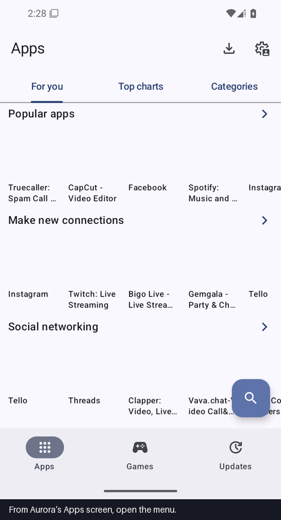

# Part 1. Download the BBC iPlayer APK with Aurora Store

Start at Aurora Store’s **Apps** screen with Aurora already installed and set up. Save the [Google TV Streamer profile](https://github.com/pholcroft/morphe-androidtv-patches/blob/feat/bbc-iplayer-1.0.1-preview/docs/bbc-iplayer/google-tv-streamer-kirkwood.properties) to your phone’s Downloads folder before starting.

If Aurora search comes up empty, use the [BBC iPlayer Play listing](https://play.google.com/store/apps/details?id=bbc.iplayer.android) on your Android phone.

1. In Aurora, open the top-right menu, then **Spoof manager → Device → ⋮ → Import**. In the file picker, open **Downloads** and select the `.properties` file.
2. Select **Google TV Streamer (kirkwood) - experimental** in the device list. Tap **Restart** when prompted.

   - **Anonymous.** If Aurora asks you to sign in, tap **Anonymous**. The animation uses this option. [Aurora Store FAQ](https://auroraoss.com/wiki)
   - **Already signed in.** Continue from Aurora’s **Apps** screen with the same steps below.

3. Search for **BBC iPlayer**. If it appears, open its listing. If it’s missing, return to this guide in your phone’s browser and tap the [exact Play listing](https://play.google.com/store/apps/details?id=bbc.iplayer.android). When you see **Continue to Aurora Store?**, tap **Open** and check the version Aurora shows.
4. If the link goes to Chrome or Play Store instead, go to Android **Settings → Apps → Aurora Store → Open by default**. Turn on **Open supported links**, tap **Add link**, select `play.google.com` and tap **Add**. Then tap the listing link from this guide again. Menu labels may vary by phone. [Android default app settings](https://support.google.com/pixelphone/answer/6271667)
5. Tap **Install** to download. When Android asks whether to install BBC iPlayer, tap **Cancel**. Dismiss Aurora’s follow-up message if it appears.
6. Return to Aurora’s **Apps** screen. Tap **Downloads**, press and hold the completed iPlayer row, then tap **Export**. Aurora 4.8.4 saves the APK download as `bbc.iplayer.android.zip`. It contains `base.apk`, `config.en.apk` and `config.xhdpi.apk`. [Aurora Store export code](https://github.com/AuroraOSS/AuroraStore/blob/master/app/src/main/java/com/aurora/store/compose/ui/downloads/DownloadsScreen.kt)
7. In a file manager, rename `bbc.iplayer.android.zip` to `bbc.iplayer.android.apks` so Morphe can open it. Keep all three APKs together in that file. The demo uses [Material Files](https://github.com/zhanghai/MaterialFiles) because the built-in file picker kept appending `.zip`. Check that the filename ends in `.apks`. [Morphe’s supported APK file formats](https://github.com/MorpheApp/morphe-manager/blob/main/docs/patching-expert-mode.md)

Continue with [Part 2. Patch the APK on your phone](morphe-phone/README.md), or copy the `.apks` file to your computer for Morphe Desktop.

## Check the version before downloading

Aurora shows the version directly under **British Broadcasting Corporation** on the listing. In **v1.0.1 (101)**, `1.0.1` is the version name and `101` is Android’s version code. For a later build, read the new code beside its version name and check the patch’s supported versions in Morphe or the patch README. Use an APK version your chosen patch supports.

The animation uses real Android emulator captures with a simulated touch marker. All three APKs in the export matched the files used to test the Morphe patch.
