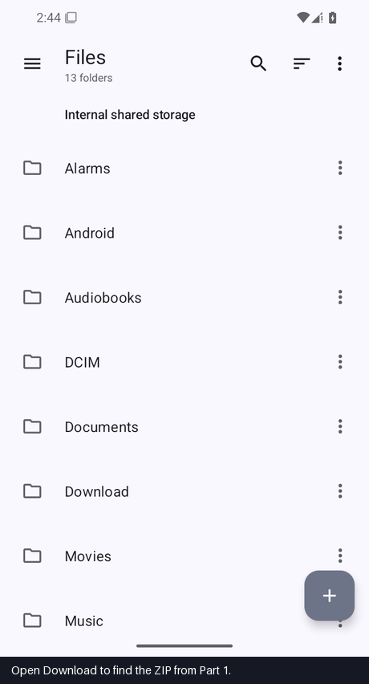

# Part 2. Patch the BBC iPlayer Android TV bundle on your phone

Start with the ZIP exported in [Part 1](../README.md), [Morphe Manager](https://github.com/MorpheApp/morphe-manager) installed and the **BBC iPlayer Android TV Preview** source loaded.

1. Download the stock iPlayer bundle using [the Aurora walkthrough](../README.md). In a file manager, rename `bbc.iplayer.android.zip` to `bbc.iplayer.android.apks`. Keep the ZIP contents together. The Android Files picker on the emulator kept a trailing `.zip`, so the demo uses [Material Files](https://github.com/zhanghai/MaterialFiles) to change the extension.
2. Turn on **Settings → Expert mode**. Under **Apps**, select **BBC iPlayer (Android TV)**. Check that Morphe recommends **1.0.1, Build 101**, then choose **No, I already have it** and select the `.apks` file. [Morphe Expert mode](https://github.com/MorpheApp/morphe-manager/blob/main/docs/patching-expert-mode.md)
3. Enable **Make iPlayer 1.0.1 work on more TVs**. To keep an existing iPlayer install on the TV, also enable **Clone app** under **Morphe Patches**. Keeping its default package setting produces `bbc.iplayer.android.morphe`.
4. Tap **Patch**. If you enabled **Clone app**, Morphe shows a two-source confirmation. Tap **Proceed anyway** for that combination. When patching finishes, tap the **Save** icon and save the signed APK to Downloads. Transfer that APK to your Android TV device.

## One-time patch source setup

Download the [BBC iPlayer preview patch bundle](https://raw.githubusercontent.com/pholcroft/morphe-androidtv-patches/acc875bc9ec0371f4eb1fd42bf8eed597f805781/docs/bbc-iplayer/preview/bbc-iplayer-1.0.1.mpp). Open the `.mpp` with Morphe and choose **Add**, or add it through **Sources → + → Select patch source files**. [Morphe source documentation](https://github.com/MorpheApp/morphe-manager/blob/main/docs/patch-sources.md)

The phone emulator ran Morphe Manager 2.7.0, applied both patches to Aurora’s three APK splits, and saved a signed Android TV APK with version name `1.0.1` and version code `101`.
